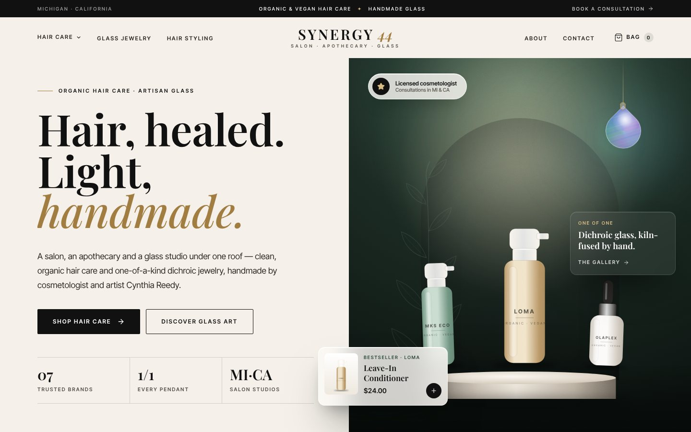

# Synergy 44 — Boutique Storefront

A multi-page Next.js (App Router) storefront for Synergy 44: organic hair care, salon services and handmade dichroic glass jewelry by Cynthia Reedy.

**Stack:** Next.js 15 · React 19 · TypeScript · Tailwind CSS 3 · Framer Motion · Lenis · lucide-react · self-hosted Playfair Display + Inter Tight (Fontsource)



## Quick start

```bash
npm install
npm run dev          # http://localhost:3000
npm run build && npm start
```

Copy `.env.example` to `.env.local` to enable email delivery for the contact form and a direct checkout link (both optional).

## Routes

| Route | What it is |
| --- | --- |
| `/` | Editorial hero with floating frosted cards (mouse parallax + tilt), brand strip, two-crafts split, featured products, glass teaser, salon teaser, testimonials, Guarantee |
| `/products/hair-care` | Full catalogue — brand chips, ritual tabs, search, sort; filters sync to `?brand=` / `?category=` |
| `/products/hair-care/[brand]` | Statically generated pages for Loma, MKS Eco, Olaplex, Neuma, Gama, Sutra, Goomee |
| `/jewelry` | Dichroic glass gallery with collection filters, shimmering cards, quick-view modal, process + commissions |
| `/about` | Cynthia’s story, timeline, the Synergy 44 Guarantee, sustainability |
| `/hair-styling` | Tabbed salon menu (Women / Men / Hi-Lights & Color / Treatments), approach, testimonials |
| `/contact` | Validated inquiry & booking form (`?topic=salon|consultation|product|jewelry|other` pre-selects) |
| `POST /api/contact` | Server validation, honeypot, per-IP throttle, email via Resend |

## Structure

```
app/                     routes, layout (fonts, providers), template.tsx (page transitions), api/contact
components/
  layout/                Navbar (mega menu + mobile sheet), Footer, SmoothScroll (Lenis)
  ui/                    Reveal, Parallax, TiltCard, BotanicalSprig, PageHeader, SectionHeading
  shop/                  ProductCard, ProductGrid (filters), ProductVisual (SVG packshots), CartDrawer
  jewelry/               PendantVisual (CSS dichroic glass), JewelryGallery, QuickViewModal
  home/                  Hero, BrandStrip, CraftsSplit, FeaturedProducts, JewelryTeaser, ServicesTeaser
  services/, contact/    PricingMenu, ContactForm
lib/
  data/                  brands, products, jewelry, content (services, testimonials, guarantee, timeline)
  cart.tsx               cart context (localStorage-persisted)
  contact.ts             shared validation for form + API
  lenis.ts, site.ts, utils.ts
```

## Design system

- **Type:** Playfair Display (600, high-contrast serif) for display, Inter Tight for UI and body. Headings are set in `#111` ink; italic champagne-gold accents (`.accent`).
- **Palette** (`tailwind.config.ts`): `ink #111`, `cream #F5F1EA`, `paper #FBF9F5`, `line #E3DCD1`, `forest #131C18`, `sage #4A6B5D`, `champagne #A27D42`.
- **Geometry:** sharp 2–6px radii, hairline rules, numbered editorial section headers (`SectionHeader`), asymmetric 12-column grids.
- **Buttons:** rectangular, tracked caps, fill-wipe hover + arrow nudge (`.btn-dark`, `.btn-outline`, `.btn-light`, `.btn-ghost-light`).
- **Glass:** `.glass` (milk glass, deep layered shadows) and `.glass-dark` for cards floating over imagery. The header is a frosted sticky bar (`backdrop-blur-md`).
- **Imagery:** `components/ui/StudioScene.tsx` renders art-directed “studio photographs” in code — spotlight, arched niche, stone plinth, botanical shadow, grain, pointer-following light — in `forest`, `stone`, `velvet` and `espresso` tones. **Pass `src` to swap in real photography** with no layout changes:

  ```tsx
  <StudioScene src="/images/loma-leave-in.jpg" alt="Loma Leave-In Conditioner on stone" className="aspect-[4/5]" />
  ```

- **Motion:** calm and fluid — Lenis inertial scroll, slow image zoom on hover (1.4s), 5–6° tilt on glass cards, scroll parallax, clip-path reveals. Everything respects `prefers-reduced-motion`.

## Before launch — content to confirm

All of these are placeholders and are flagged in the data files:

- **Products** (`lib/data/products.ts`) — names, sizes, prices. Sync with WooCommerce, or fetch from the WC Store API.
- **Jewelry** (`lib/data/jewelry.ts`) — piece names, sizes, prices.
- **Services** (`lib/data/content.ts`) — prices and durations.
- **Testimonials** — quotes are illustrative. Replace with clients’ verbatim reviews (with permission).
- **Guarantee and biography wording** — confirm with Cynthia.
- **Imagery** — scenes, packshots and pendants are drawn in code. Pass real photos to `StudioScene` via `src` (see above), and replace `ProductVisual` / `PendantVisual` with `next/image` once product photography exists.
- **Checkout** — the bag works locally. Set `NEXT_PUBLIC_CHECKOUT_URL` or wire `lib/cart.tsx` to the WooCommerce Store API / Stripe. Until then the bag offers “Request this order”, which sends the bag contents through the contact form.
- **Newsletter** — footer form is UI only. Connect it to Mailchimp, Klaviyo or similar.
- **Contact email** — `site.contactEmail` in `lib/site.ts` is shown on `/contact` only once set.

## Deploying

Works on Vercel with zero config. Add the environment variables from `.env.example` in the project settings.
